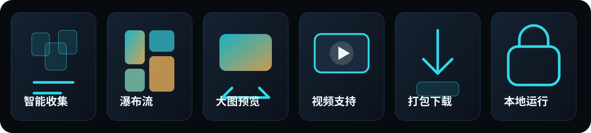

# 瀑光 FlowLens


> 把网页中的图片和视频，一键整理成沉浸式全屏瀑布流。当前版本：**v2.0.25**。

FlowLens 是一个浏览器工具：它会收集网页上零散、分页、尺寸不一的图片与视频，整理成可连续浏览、筛选、放大、收藏和下载的图片流。电脑端和手机端共享核心代码，手机端额外加载触控、窄屏和折叠屏适配。



## 快速安装

普通用户只需要安装下面两个正式入口之一：

| 版本 | 安装链接 | 适用场景 |
|---|---|---|
| 电脑端 | [安装/更新 FlowLens desktop](https://raw.githubusercontent.com/fallen0909/flowlens/master/flowlens-desktop.user.js) | Edge、Chrome、Firefox + Tampermonkey |
| 手机端 | [安装/更新 FlowLens mobile](https://raw.githubusercontent.com/fallen0909/flowlens/master/flowlens-mobile-all.user.js) | Android Edge、Kiwi、Firefox 等支持脚本管理器的移动浏览器 |
| 安装页 | [打开安装页](https://fallen0909.github.io/flowlens/) | 图形化安装入口 |

当前版本信息见 [version.json](version.json)。

## 2.0.25 更新重点

- 视频加载提示去掉项目序号。封面恢复在播放器内按原有方式显示，加载时仍可滑动切换。

## 2.0.24 更新重点

- 手机滑动立即切换视频。下一条还在缓冲时，会显示该视频的封面或加载提示，期间仍可继续滑动。
- 保留后续最多四条视频的预缓冲，优先处理最近的项目，同时最多两条等待首帧并复用已加载的播放器。

## 2.0.23 更新重点

- 手机大图内可上下滑动切换视频。新视频首帧就绪后再做滑动过渡，等待时保留上一条画面，支持系统减少动态效果设置。
- 打开图库时提前建立视频源连接。多线路视频已收到数据时保留加载宽限，预加载视频转为播放时沿用原计时。

## 2.0.22 更新重点

- 当前视频稳定播放后，预缓冲下一条可见视频。切换时复用播放器和已缓冲的数据，支持普通视频和防盗链播放器。
- 预缓冲一次只保留一条，当前播放卡顿、拖动进度或切到后台时让出带宽。
- 多线路视频无响应时更早尝试下一来源，已经收到元数据的线路保留加载时间。

## 2.0.21 更新重点

- 电脑和手机进入图片 1:1 放大时隐藏工具栏、切图箭头和滚动条。仍可拖动图片，轻点图片恢复适应屏幕和控件。

## 2.0.20 更新重点

- 大图控件按钮统一放大至 48px，内部图标由 18px 放大至 28px；左右箭头保持水平和垂直居中，沿用外层工具栏风格。

## 2.0.19 更新重点

- 统一大图控件与外层工具栏的背景、边框、阴影及图标尺寸；左右切图改用对称 SVG 箭头并精确居中，保留收藏和缩放状态色。

## 2.0.18 更新重点

- 大图库追加媒体按游标只检查新增地址；移除图片或换组时重置对应游标，保留高清地址替换逻辑。
- 追加时不再同步全部卡片索引；全部媒体模式的计数不再扫描筛选结果。
- 修复建卡队列处理中移除图片后，后续待建卡片索引错位的问题。
- 3,000 张 / 150 批的追加回归中，地址检查从 226,500 次降为 3,000 次；此数值为工作量计数，不代表 FPS 提升比例。

## 2.0.17 更新重点

- 分批建卡只观察新增卡片，避免随图库增大反复扫描全网格；每帧建卡预算降至 5 ms，后台标签暂停建卡、恢复可见后续建。
- 视频手势层将滚动、尺寸变化和元数据事件合并为每帧一次定位，卸载时取消任务；补充 visualViewport 滚动跟随。
- 统一系统字体、圆角、按压反馈、键盘焦点和触控尺寸；支持减少动态效果，移除卡片逐图强制合成和重复的按钮背景模糊。
- 新增 src/ui 视觉层、config/modules.json 构建清单、锁定测试依赖和 npm 构建/测试入口；GitHub 自动运行回归并检查构建产物一致性。

## 开发与维护

需要 Node.js 22 或更新版本。首次执行 `npm ci`，使用 `npm test` 跑全部回归，`npm run build` 生成电脑端、手机端、预览版和扩展源码并校验版本。目录职责与修改入口见 [架构说明](docs/ARCHITECTURE.md)。

## 2.0.16 更新重点

- 修复 x.810114 的 React 将 `@` 与账号名拆成独立文本节点，导致侧栏分组读取为空、回退到错误历史队列并请求 404 的问题；读取完整账号标签，排除插件自身及页脚邮箱，支持未加载媒体数的账号。
- 新增与实际站点一致的分离文本节点回归，验证无媒体数、英文昵称及单个账号；增加可选真实接口测试，验证侧栏七组连续下一组、首尾切换、上一组及失败后恢复。
- 更新脚本后刷新原网站，让当前侧栏重建分组队列。

## 2.0.15 更新重点

- 修复 x.810114 分组顺序被较长的历史缓存覆盖的问题；优先按当前侧栏相邻账号切换，上一组不再跳过最近访问的账号。
- 适配站点 V2 timeline 接口，保留旧版接口及跨域备用读取；请求支持取消与超时，校验返回的账号身份和数据结构。扩展后台允许在原有大小限制内读取 JSON。
- API 切组不再等待只有 React 外壳的 HTML；保留原侧栏队列及新组标题。读取失败保留当前组，随后可继续下一项，也可从组列表重试失败项。
- 新增 SLZJTT 相邻分组、旧缓存顺序、V2/旧版/跨域回退、取消、超时、失败后继续及扩展 JSON 回归。

## 2.0.14 更新重点

- 修复手机端滑动出现提示却不跳转：增加透明手势区域和非被动 Touch 事件处理，避免原生播放器取消 Pointer 事件后丢失滑动目标；普通和防盗链播放器均适用。
- 拖动中原生暂停不再清除目标；支持快速滑动只有结束坐标的情况，松手后保留跳转反馈；多指、真正的触摸取消、隐藏和卸载仍安全取消。
- 点播跳转按完整时长限制，不再夹在当前 seekable 区间，允许浏览器请求目标片段；底部原生进度条保持可操作。

## 2.0.13 更新重点

- 图片/视频筛选真正隐藏不匹配卡片并重新排紧，修复黑色占位；切换筛选返回顶部，隐藏媒体立即释放，初次渲染也不加载隐藏媒体。
- 手机视频播放器长按约 450 毫秒临时 2 倍速，松手恢复原倍速；左右滑动显示快进/快退预览，松手后跳转，保留底部原生播放和进度控件。
- 普通及防盗链播放器共用手势逻辑；取消、后台、失焦、切换媒体和卸载时恢复倍速并清理监听。
- 打开大图时回收网格视频预览，减少起播竞争；优先使用本会话已播通的视频源；手机上完全无响应的多源视频在 2.5 秒时尝试备用源，已读到元数据的源保留加载宽限。

## 2.0.12 更新重点

- 统一大图邻图预加载并限制缓存，淘汰视频时移除节点；取消重复的图片缓存和异步 src 补丁。
- 广告过滤缓存配置、按新增卡片增量处理，使用媒体源尺寸，避免逐卡片强制布局；高清解析合并相同请求，旧组结果不写入新组缓存。
- 切组使用当前组文档与待切换目标；快速连续点击只提交最后一次请求，失败或空组图保留当前组，关闭重开不会回到原网页组图，移除过时请求的页面跳转回退。
- ZIP 按 64 MiB 分包，校验计算分块让出主线程，支持取消、失败列表与失败项重试。单个超过 64 MiB 的文件独立保存。

## 2.0.11 更新重点

- 放大时在同一次布局中完成尺寸变化和居中，取消核心和手机补丁重复定位以及 140 毫秒后的延迟居中，减少可见跳动。
- 手机大图不再强制 3D transform、背面隐藏或预建变换图层，保持放大前后的绘制方式一致；关闭大图滚动锚定，避免浏览器额外调整位置。
- 横竖屏变化合并到一帧处理；新增定位次数和延迟跳动回归测试，保留首次放大、拖动、延迟加载等检查。

## 2.0.10 更新重点

- 修复手机版大图首次放大后被居中补丁缩回的问题。核心统一设置放大尺寸，手机补丁只负责居中，保留 1.5 倍放大和后续缩放比例。
- 返回适应屏幕或关闭大图时取消待执行的居中；图片切换后的旧加载回调不再移动新图片，拖动期间不抢位置。
- 新增手机高像素密度、首次点击、重复放大、横竖屏切换和延迟加载回归测试。

## 2.0.9 更新重点

- 修复按需加载卡片漏掉观察器通知后可能一直显示黑色占位的问题：滚动、布局变化、返回标签页和关闭大图后检查当前可见区域。
- 附近已挂载的图片直接加载和绘制，避免虚拟占位、浏览器图片懒加载与内容跳过绘制叠加等待；屏外媒体仍按原逻辑回收。
- 大图库按瀑布流列定位附近卡片，避免逐张测量整库；新增漏通知恢复和 3000 张图库的回归检查。

## 2.0.8 更新重点

- 兼容 xChina 新版 `/photo/编号` 和旧版套图地址，仅收集当前套图编号下的图片，排除侧栏相关套图与推广素材。
- 从真实分页链接读取页码与地址格式，补齐省略页码；移除 xChina 上盲猜千页的逻辑，末尾自动继续加载。
- 套图分页按顺序、间隔请求；安全验证页与空套图不记作成功，失败分页保留重试。正常 Cloudflare 统计脚本不再误触验证页判断。

## 2.0.7 更新重点

- 视频封面复用网页 poster、缩略图与站点数据；无封面时按可见位置加载首帧，最多并发 3 个，不再为封面下载整段视频。
- 受防盗链保护的视频预览使用无来源信息页面，减少跨域截图失败与重复加载。
- 大图库只挂载屏幕附近的媒体，远处保留尺寸占位；回滚恢复同一条目，保留选择与编号。
- 图片加载不再整体移出重排卡片；批量布局减少交错读写，浏览位置只检查附近卡片；生成的首图缓存最多 100 张。

## 2.0.6 更新重点

- x.810114 视频处理代理限流和防盗链，优先使用原始源，加载失败自动切换备用源；原生播放与进度控件不再被拖动手势拦截。
- 连播时放大图片会等待，恢复适应屏幕后继续；手动停止后不会自动重启。
- 设置整合为显示与播放、磁力与转存、页面收藏、过滤与诊断四个模块，广告过滤和站点状态不再游离在面板外。
- 相邻视频只预取元数据，限制预加载缓存；大图打开时暂停网格视频预览队列，忽略无关文字和样式变化。

## 2.0.5 更新重点

- 修复大图自动播放按钮、直接视频与 iframe 视频的自动播放回退。
- 修复关闭后重复刷新、原网站滚动锁被清除、旧图库请求混入新图库。
- 失败分页可重试，设置按实际变更保存，不再由旧标签页覆盖。
- 移除事件注册原型补丁；油猴入口改为单文件发布。

## 2.0.4 更新重点

- 设置面板改为“显示与浏览、磁力与播放、页面收藏、高级设置”四个可折叠模块，统一字号、间距、开关和输入控件。
- 修复大图自动播放控制器冲突，以及视频结束后反复播放当前视频、不能切换下一项的问题。
- 磁力播放新增 CloudDrive2 流媒体和本地挂载文件两种方式；已有文件会立即播放，不再显示“播放等待”设置。
- PornPics 后续组按画廊 ID 和当前语言去重，只收集带图片的画廊卡片，并过滤站点标识后显示真实预览图。

## 2.0.3 更新重点

- 磁力/ED2K 的转存与播放改为油猴脚本直连 CloudDrive2，不再依赖 115 Magnet Play 插件。
- 设置中新增 CloudDrive2 地址、115 目录、API Token 和连接测试；Token 仅保存到油猴/扩展私有存储。
- 播放会自动等待 115 离线任务完成、定位视频并打开 CloudDrive2 流媒体地址。

## 2.0.2 更新重点

- 页面收藏与收藏列表移入设置，减少顶部工具栏占用。
- 大图模式移除链接抓取按钮，并修复缩放、拖动后按钮和箭头随内容漂移。
- 磁力/ED2K 面板支持 `M` 快捷键，并可批量或逐条保存到 CD2/115、逐条在浏览器播放。

## 2.0.1 更新重点

- 大图控件改为常驻节点，自动播放切图不再销毁控件或触发闪动动画。
- 新增大图缩放按钮，开启后支持滚轮连续缩放和拖动查看。
- 后续组改用独立图库图标并显示预览图。
- 新增 magnet / ed2k 页面下载链接抓取、复制与 TXT 导出。

## 2.0.0 更新重点

- “下一组”右侧新增组列表，可预览后续组标题并直接跳转。
- 设置面板改为更紧凑的分区布局，高级广告过滤与快捷键默认收起。
- 扩展设置页版本改为自动读取 manifest，避免再次显示旧版本号。

## 1.10.0 更新重点

- 修复大图自动播放按钮无法连续切换图片的问题。
- 优化图片流按需注入、分帧渲染和瀑布流布局，长列表加载与滚动更顺畅。
- 扩展设置和收藏迁移到扩展存储，并收紧下载与跨域请求权限。

## 1.9.9 更新重点

- 修复 1.9.8 中会话恢复与用户手动滚动抢控制权的问题，避免刚下拉就跳回顶部。
- 用户滚轮、触摸、拖动滚动条或使用键盘滚动时，会立即取消本次自动恢复。
- 恢复定位改为即时 `auto` 定位，避免平滑滚动动画造成回弹感。

## 功能

- 将页面图片和视频整理成全屏瀑布流。
- 支持图片/视频筛选、大图浏览、原始尺寸拖动、图库式滑动、稳定工具栏、幻灯片、下载与链接导出。
- 支持页面收藏、低频跨设备同步和诊断日志导出。
- 支持手机触控浏览、窄屏与折叠屏布局。
- 支持 Meitulu `item/编号.html`、`item/编号_2.html` 等多页套图补齐采集。
- 支持知乎页面同源重复媒体合并，避免重复卡片。

## 使用

### 电脑端

1. 安装 Tampermonkey。
2. 打开 [flowlens-desktop.user.js](flowlens-desktop.user.js) 并安装。
3. 打开任意网页，点击右下角“瀑光”入口。

### CloudDrive2 直连

1. 打开 CloudDrive2 网页端的“API Tokens”，创建一个允许浏览文件、搜索、创建文件夹、添加/查看离线任务和读取文件的 Token。
2. 在瀑光设置的“CloudDrive2 直连”中填写服务地址、115 转存目录与 Token，点击“测试连接”。
3. 在任意网页按 `M` 抓取 magnet/ED2K，可逐条播放、转存，或一键全部转存。

### 手机端

1. 使用 Android Edge、Kiwi 或 Firefox 等支持脚本管理器的浏览器。
2. 安装 Tampermonkey。
3. 打开 [flowlens-mobile-all.user.js](flowlens-mobile-all.user.js) 并安装。

## 建议继续优化的方向

| 优先级 | 方向 | 目标 |
|---|---|---|
| 高 | 下载任务中心 | 显示成功、失败、跳过和可重试列表，提升批量下载可控性 |
| 高 | 缩略图到大图转场 | 从瀑布流卡片位置放大进入大图，进一步接近系统图库 |
| 中 | 智能高清解析缓存 | 对已解析过的高清地址做持久缓存，二次打开秒切高清 |
| 中 | 设置导入导出 | 方便手机和电脑同步列数、主题、自动滚动、收藏等设置 |
| 低 | 发布页美化 | 安装页展示版本、更新说明、电脑/手机步骤和常见问题 |

## 项目结构

```text
flowlens-desktop.user.js      电脑端正式安装入口
flowlens-mobile-all.user.js   手机端正式安装入口
apps/extension/               Chrome / Edge 扩展源码
src/                          两端共享源码
  core/                       核心逻辑
  patches/                    功能补丁
  mobile/                     手机端适配
docs/                         安装页、素材和历史资料
tools/                        构建、校验和本地开发工具
```

`src/` 是电脑端、手机端和扩展端共享逻辑的唯一来源。发布入口打包为完整的 `.user.js`，源码仍按模块维护，避免依赖缓存造成混合版本。

## 开发与发布

```bash
node tools/validate-release.mjs
node tools/build-userscripts.mjs
node --check flowlens-desktop.user.js
node --check flowlens-mobile-all.user.js
```

GitHub Actions 已改为手动运行，避免普通提交触发不必要的失败邮件。需要打包时，可在 Actions 页面手动运行 `Verify and package FlowLens`。

完整历史记录请查看 [变更日志](docs/CHANGELOG.md)。

行为回归：`node tools/test-desktop-behavior.mjs`。xChina 的 DOM 分页回归先执行 `npm install --prefix tools --no-save --package-lock=false linkedom`，再运行 `node tools/test-xchina-gallery.mjs`；测试使用本地模拟页面，无需访问站点。

可见媒体恢复回归：`node tools/test-virtual-media.mjs`，覆盖漏掉观察器通知、屏外回收、滚回恢复、大图暂停和隐藏标签页。

手机大图缩放回归：`node tools/test-mobile-zoom.mjs`，覆盖首次点击后尺寸保持、重复放大、横竖屏切换、延迟加载和切图后的旧回调。

性能与切组回归：安装与分页测试相同的 linkedom 依赖后运行 `node tools/test-performance-navigation.mjs`。

筛选与视频手势回归：`node tools/test-media-filter-gestures.mjs`（使用相同的 linkedom 测试依赖）。

x.810114 分组回归：`node tools/test-x810114-navigation.mjs`（使用相同的 linkedom 测试依赖）。
